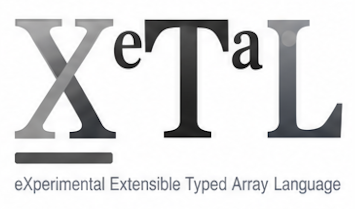
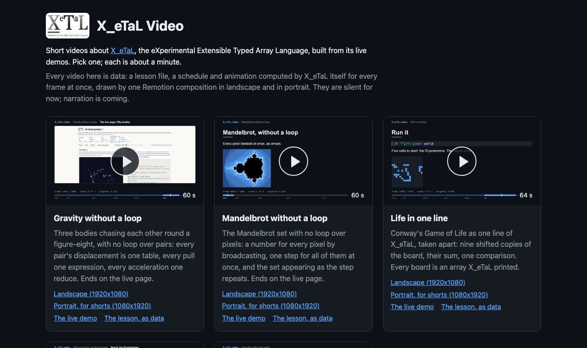

# X_eTaL video



<p align="center">
  <b><a href="https://softwarewrighter.github.io/X_eTaL-video/">Watch the videos: softwarewrighter.github.io/X_eTaL-video</a></b>
  <br>the live page: every video, in landscape and in portrait
</p>

[](https://softwarewrighter.github.io/X_eTaL-video/)

Educational videos about
[X_eTaL](https://github.com/softwarewrighter/X_eTaL), the
eXperimental Extensible Typed Array Language, built from its live
demos: a lesson is data, X_eTaL computes its timing and animation as
arrays, a deterministic renderer draws every frame, and the existing
video tools assemble the result.

Status: early. Three X_eTaL libraries for timing and animation are
tested, and five lessons are rendered with Remotion in landscape and
portrait. The N-body short is narrated in the author's cloned voice
(`just voice`, below); the others are silent so far. `docs/plan.md`
has the roadmap.

## Narration

`just voice SLUG` speaks each scene's `narration` in the author's
cloned voice: VoxCPM (its Gradio API, on `queenbee.local:7860` by
default, `XETAL_TTS` to change it) with the voice sample and exact
transcript in `../video-publishing/reference/voice/`
(`mike-medium-ref-1.wav`, `prompt-text.txt`; not tracked anywhere).
A sentence a call, one call at a time; every clip is checked by a
local whisper (`whisper-cli`, `ggml-medium.en` in
`~/.local/share/whisper-cpp/models/`) and made again when its words
differ. Each scene's length becomes its audio's, `timing.json` is
recomputed, and `lessons/SLUG/voice.json` records what was said and
heard. Narration is checked before any call (`just voice SLUG
--check`): words, commas and periods only, no digits or all-caps
words, short sentences, which is what VoxCPM speaks cleanly. Needs
`sox`, `whisper-cpp` and `uv` (the client runs in `.venv`).

## How it fits

| Layer | Where | Responsibility |
| ----- | ----- | -------------- |
| The language and its demos | [X_eTaL](https://github.com/softwarewrighter/X_eTaL), [X_eTaL-demos](https://github.com/softwarewrighter/X_eTaL-demos), [X_eTaL-ML](https://github.com/softwarewrighter/X_eTaL-ML), [X_eTaL-games](https://github.com/softwarewrighter/X_eTaL-games), [X_eTaL-libraries](https://github.com/softwarewrighter/X_eTaL-libraries) | what a video is about: programs, their output, the live pages |
| This repository | `libs/`, `lessons/`, `remotion/` | lessons as data; timing and animation computed in X_eTaL; scenes rendered in landscape (1920x1080) and portrait (1080x1920) |
| Assembly and publishing | the author's video repositories (long-form and shorts) | loudness, intro and outro, concatenation, upload |

## What is here

| Path | What |
| ---- | ---- |
| `libs/` | X_eTaL libraries for video timing and animation (below) |
| `lessons/` | lessons as data, each with the schedule X_eTaL computes from it: [making-of](lessons/making-of/), [life](lessons/life/), [life-capture](lessons/life-capture/), [mandelbrot](lessons/mandelbrot/), [nbody](lessons/nbody/) |
| `schemas/` | `lesson.schema.json`: what a lesson file may contain, checked by the gate |
| `remotion/` | the [Remotion](remotion/) renderer: one composition that renders any lesson, in both formats |
| `images/` | this repository's logo and favicon (X_eTaL's, in a very light gray) and the live page's picture above (`just screencapture` retakes it) |
| `docs/plan.md` | the plan: decisions, the survey of the existing video pipelines, libraries, lessons, roadmap, open questions |
| `docs/remotion-scripts.md` | the proposed scripts: voice, timing, capture, render, assemble (proposals, not yet run) |
| `docs/research.txt` | the conversation the idea came from (archival, trimmed) |
| `docs/xetal-asks.md` | what this work needs from X_eTaL |

## Libraries

| Library | What |
| ------- | ---- |
| [Timeline](libs/Timeline/) | frames and seconds; where each scene starts and ends; the scene a frame is in and its progress through it |
| [Ease](libs/Ease/) | ramps, lerps and easing curves, after Remotion's `interpolate` and `Easing`; a stagger table for things that appear in turn |
| [Spring](libs/Spring/) | a damped spring's position at any time and its settle time, after Remotion's `spring` and `measureSpring`, checked against Remotion's own numbers |

```
"tl:" u_se< "Timeline"
durs := 30 tl:f_rames 3 5 2      # 90 150 60: three scenes, in frames
tl:s_tarts durs                  # 0 90 240
durs tl:s_cene 0 89 90 299       # 1 1 2 3
```

`just run Timeline` runs its test programs; `just test-lib Timeline`
checks its baselines.

## A first video: how it was made

```bash
cd remotion && npm ci && cd ..   # once
just render making-of            # out/making-of-landscape-remotion.mp4 (1920x1080, 58 s)
just render making-of portrait   # out/making-of-portrait-remotion.mp4 (1080x1920)
just studio making-of            # Remotion Studio at http://localhost:8427
just draft making-of             # the same lesson without Remotion (ImageMagick, ffmpeg)
```

`lessons/making-of/lesson.json` is the content. X_eTaL (Timeline and
Ease) computes the schedule and every frame's animation numbers, all
1740 frames at once; the renderer only places things, looking each
frame's numbers up. The numbers on screen are the video's own. Two
renderers read the same numbers: Remotion (React), and a draft
renderer with nothing to install beyond `node`, `magick` and
`ffmpeg`. [`lessons/making-of/`](lessons/making-of/) has the details.

## A lesson from a live demo: Life

```bash
just render life             # out/life-landscape-remotion.mp4 (64 s)
just render life portrait
```

Conway's Life as the
[life-microscope](https://softwarewrighter.github.io/X_eTaL-demos/life-microscope/)
demo writes it: the one-line rule, the nine shifted copies of the
board, their sum, the comparison, then 47 generations. Every board on
screen is an array X_eTaL printed (`lessons/life/data.xtl`).

The same lesson exists a second way, to compare:
[`lessons/life-capture`](lessons/life-capture/) shows the published
page itself, recorded in headless Chromium while a script clicks
through it (`just capture life-capture`, then `just render
life-capture`).

## 60 second shorts: N-body gravity, Mandelbrot

`lessons/nbody`: three bodies round a figure-eight with no loop over
pairs: every pair's displacement is a table, every pull one
expression, every acceleration one reduce (`just capture nbody`, then
`just render nbody portrait`).

```bash
just capture mandelbrot             # record the live page (network)
just render mandelbrot portrait     # out/mandelbrot-portrait-remotion.mp4
```

The Mandelbrot set with no loop over pixels: a number for every pixel
by broadcasting, one step for every pixel at once, the step repeated
while the set appears (the demo's own program, run by X_eTaL for the
video), then the published page itself, recorded.

## The live page

<https://softwarewrighter.github.io/X_eTaL-video/> is a landing
page with a thumbnail for every video; choosing one plays it, and
each has links to both formats, to its live demo and to its lesson.

```bash
just pages          # build it into pages/ (renders what is missing or stale)
just serve-pages    # preview at http://127.0.0.1:8427/X_eTaL-video/
just publish        # make pages/ the gh-pages branch, which GitHub Pages serves
```

A lesson's `summary`, `order` and `poster` (the frame used as its
thumbnail) in its `lesson.json` are what the page shows. `pages/` is
not tracked on `main`.

## X_eTaL as rendered

X_eTaL source in a video is shown as the live pages show it, never
as typed: a lesson's `{"xtl": "u:l_ife := { ... _r }"}` line is
rendered by the pinned `xetal render --html` (underlined function
letters, raised namespaces, subscript axes) and drawn in JuliaMono
with X_eTaL's syntax colors. `scripts/fetch-fonts.sh` fetches the
font (SIL Open Font License; not tracked), and `just render` runs it.

## Build

Needs: Rust (to build X_eTaL), [just](https://github.com/casey/just),
`reg-rs` and `sw-markdown-checker` (Software Wrighter's tools), and
`uv` (the spelling check runs through it). Rendering needs Node
(`cd remotion && npm ci`) and `ffmpeg`; the gate checks the Remotion
project only when its packages are installed.

```bash
just xetal        # clone X_eTaL at the commit in XETAL_COMMIT into work/xetal, build bin/xetal
just eval "'+ s_\\ 90 150 60"     # evaluate with the pinned xetal: 90 240 300
just gate         # everything checked before a commit
just              # every recipe
```

X_eTaL is pinned: `XETAL_COMMIT` names the commit every script uses,
so results do not change under a lesson.

## Remotion's license

The renderer is [Remotion](https://www.remotion.dev/) (React and
TypeScript), in `remotion/`. Remotion has its own license: free for
individuals and for companies of three or fewer people, a company
license beyond that. If you build videos with this repository, check
that its terms fit you.

## Development

Development is tracked with agentrail sagas, as in X_eTaL: `agentrail
status` shows the current step, `agentrail next` its instructions.
Every step ends with the gate passing, docs updated, a commit to
`main` and a push. `CHANGES.md` lists every commit.

## Related Projects

- [X_eTaL](https://github.com/softwarewrighter/X_eTaL) -- the language
  ([try it live](https://softwarewrighter.github.io/X_eTaL/))
- [X_eTaL-demos](https://github.com/softwarewrighter/X_eTaL-demos) --
  visual array and scientific programs
  ([live](https://softwarewrighter.github.io/X_eTaL-demos/))
- [X_eTaL-ML](https://github.com/softwarewrighter/X_eTaL-ML) -- the
  machine-learning demos
  ([live](https://softwarewrighter.github.io/X_eTaL-ML/))
- [X_eTaL-games](https://github.com/softwarewrighter/X_eTaL-games) --
  games and puzzles
  ([live](https://softwarewrighter.github.io/X_eTaL-games/))
- [X_eTaL-libraries](https://github.com/softwarewrighter/X_eTaL-libraries)
  -- reusable libraries
  ([live](https://softwarewrighter.github.io/X_eTaL-libraries/))

## Links

- Blog: [Software Wrighter Lab](https://software-wrighter-lab.github.io/)
- Discord: [Join the community](https://discord.com/invite/Ctzk5uHggZ)
- YouTube: [Software Wrighter](https://www.youtube.com/@SoftwareWrighter)

## Copyright

Copyright (c) 2026 Michael A Wright

## License

MIT. See [`LICENSE`](LICENSE) and [`COPYRIGHT`](COPYRIGHT).
